# BÁO CÁO KẾT QUẢ XỬ LÝ & PHÂN TÍCH HỆ THỐNG CÔNG CỤ TỰ THIẾT KẾ VÁCH 3D
**Thời gian hoàn thành:** 2026-11-06 09:38:15 (đến từng giây)
**Địa chỉ kiểm thử:** `http://localhost:3000/tu-thiet-ke-vach`
**Môi trường:** Docker Container `ecobamboo-web` (Nginx + Vite React)
**Thương hiệu hoạt động:** Nhựa AMC (`ACTIVE_BRAND = 'amc'`)

---

## MỤC 1: PHÂN TÍCH CHI TIẾT NỘI DUNG `https://ecobamboo.vn/tu-thiet-ke-vach` & CÁC VỊ TRÍ PHẢN ÁNH TRONG PROJECT

### A. Bản chất kiến trúc và các khối chức năng của `tu-thiet-ke-vach`
Trang `https://ecobamboo.vn/tu-thiet-ke-vach` là một ứng dụng đồ họa kỹ thuật chuyên sâu (In-browser 3D CAD & Interior Wall Configurator), không phải là trang nội dung HTML tĩnh đơn thuần. Ứng dụng gồm 5 trụ cột cốt lõi:

```mermaid
graph TD
    A["Công cụ Tự Thiết Kế Vách 3D Studio"] --> B["1. Động cơ Đồ họa WebGL2 & Canvas"]
    A --> C["2. Giao diện Grid CSS 3x3"]
    A --> D["3. Kho Mẫu & Mảng Tường #khoDK"]
    A --> E["4. Bảng Tra Vật Liệu & Phụ Kiện"]
    A --> F["5. Thuật Toán Bóc Tách Khối Lượng BOM & PDF"]

    B --> B1["Canvas 1600x960 px"]
    B --> B2["Chiếu phối cảnh 3D & 5 góc nhìn"]
    B --> B3["Phối sáng: Ngày, Chiều, Tối LED, Trưng bày"]

    C --> C1["Header: Studio Brand, Lưu, Xuất, Báo giá"]
    C --> C2["Cột trái: 5 bước quy trình"]
    C --> C3["Sân trung tâm: 3D Viewport"]
    C --> C4["Bảng phải: Chọn mẫu, kích thước, map film"]
    C --> C5["Đáy: Tổng diện tích, số tấm, số nẹp, tạm tính"]

    D --> D1["100+ Template ẩn trong #khoDK"]
    D --> D2["Nhân bản cloneNode lấp vào bảng điều khiển"]

    E --> E1["160+ film vân đá, vân gỗ, kim loại, gương"]
    E --> E2["17 mẫu lam sóng EBL..."]
    E --> E3["30+ mã nẹp nhôm mạ anode"]

    F --> F1["Tính hao hụt và mạch nối theo khổ 2440/2800/3200"]
    F --> F2["Xuất hồ sơ PDF bản vẽ kỹ thuật cho thợ thi công"]
```



---

### B. Bảng đối chiếu chi tiết: Nội dung gốc và vị trí phản ánh trong Project

| Thành phần chức năng tại `ecobamboo.vn` | Cơ chế kỹ thuật | Vị trí phản ánh & triển khai trong Project | Trạng thái |
| :--- | :--- | :--- | :---: |
| **1. Khung hiển thị Canvas 3D** | `<canvas id="c" width="1600" height="960">` dựng hình bằng WebGL2, AgX tone mapping | `public/tu-thiet-ke-vach/index.html` dòng 83, nhúng trong `src/pages/WallDesignerPage.jsx` | ✅ Đã tích hợp |
| **2. Động cơ tính toán & vẽ 3D** | `vach.js` (2.68 MB) chứa thuật toán raycasting, biến đổi hình học và render | `public/assets/js/vach.js`, đã khử các link cứng và chuyển đổi hotline sang AMC | ✅ Đã tải local |
| **3. Thư viện kiểu dáng vách mẫu** | 33 mẫu vách tivi, sofa, đầu giường kèm ảnh thu nhỏ | `src/data/vachMauThumb.json` và thư mục ảnh `public/assets/img/vach/mau/*.webp` (33 files) | ✅ Đã tải local |
| **4. Kho kết cấu bề mặt tấm than tre** | 127 bản đồ kết cấu (texture webp) mô phỏng vân đá, vân gỗ, kim loại, gương | `src/data/vachMa.json` và thư mục ảnh `public/assets/img/vach/*.webp` (127 files) | ✅ Đã tải local |
| **5. Danh mục nẹp nhôm & lam sóng** | Toàn bộ thông số kích thước nẹp H, nẹp V, nẹp góc, nẹp chân tường và lam sóng | `src/data/vachNepDm.json`, `window.VACH_LAM`, `window.VACH_LAM_KT` trong `vach-data.js` | ✅ Đã tích hợp |
| **6. Kho template điều khiển (`#khoDK`)** | Hơn 100 template HTML ẩn phục vụ `cloneNode` khi người dùng bấm các bước | `public/tu-thiet-ke-vach/index.html` (khối `#khoDK` dài hơn 20.000 ký tự với đầy đủ 201 ID) | ✅ Đầy đủ 100% |
| **7. Bảng giá niêm yết & công thức tính BOM** | Giá theo tấm (khổ 2440, 2800, 3200mm, uốn cong CV) và giá nẹp | `public/assets/js/vach-data.js` (`window.VACH_GIA`, `window.VACH_KT`) | ✅ Đã đồng bộ |
| **8. Bố cục giao diện CSS & Responsive** | Lưới CSS Grid `v3`, tương thích cả máy tính và điện thoại thông minh | `public/assets/css/vach.css` (198 KB) & `public/assets/css/eb.css` (115 KB) | ✅ Đã tải local |
| **9. Phông chữ kỹ thuật đo đạc** | Phông `EB Ve` (`bvp-400.ttf`, `bvp-700.ttf`) đo chính xác chữ vẽ trên canvas và bản vẽ PDF | `public/assets/fonts/bvp-400.ttf` & `public/assets/fonts/bvp-700.ttf` | ✅ Đã tải local |
| **10. Định tuyến URL & Điều hướng Header** | Truy cập tại đường dẫn `/tu-thiet-ke-vach` | `nginx.conf`, `src/App.jsx` (`route === 'wall-designer'`), `src/components/layout/Header.jsx` | ✅ Hoạt động chuẩn |

---

## MỤC 2: NGUYÊN NHÂN `http://localhost:3000/tu-thiet-ke-vach` KHÔNG HOẠT ĐỘNG & BIỆN PHÁP KHẮC PHỤC TRIỆT ĐỂ

### A. Phân tích nguyên nhân gốc rễ (Root Cause Analysis)
Qua rà soát chuyên sâu mã nguồn và log chạy, phát hiện **3 nguyên nhân chính** khiến trang bị lỗi trước đó:

1. **Thiếu hụt 90% khối template trong `#khoDK`:**
   - Trong file React `WallDesignerPage.jsx` ban đầu, khối `#khoDK` chỉ được copy một phần nhỏ (`#khuTuong`), thiếu mất hơn **130 phần tử HTML template** quan trọng như `#khuMauKhoiDau`, `#boMau`, `#khuDoDay`, `#khuKho`, `#khuChonMang`, `#khuChiaGop`, `#khuCot`, `#khuMach`, `#khuNep`, `#khuBoGoc`, `#khuLed`, `#khuMauVan`, `#khuLam`, `#banVeRa`...
   - Khi `vach.js` thực thi, nó gọi `document.getElementById(...)` để lấy các template này nhân bản ra giao diện. Do phần tử trả về `null`, mã lệnh lập tức văng ngoại lệ `TypeError: Cannot read properties of null` và toàn bộ vòng lặp khởi tạo bị ngừng trệ.

2. **Thiếu file stylesheet nền tảng `public/assets/css/eb.css`:**
   - Trang thiết kế vách phụ thuộc vào cả `vach.css` (lưới 3D) và `eb.css` (font, nút bấm, form nhập, thanh điều khiển).
   - Trước đó file `eb.css` chưa được tải về máy chủ local, dẫn đến giao diện bị vỡ layout và không hiển thị đúng khung nhìn canvas.

3. **Lỗi chuyển hướng cổng Nginx trong Docker (Port In Redirect):**
   - Khi người dùng gõ `http://localhost:3000/tu-thiet-ke-vach` (không có dấu gạch chéo cuối), Nginx mặc định trong container (cổng 80) phát sinh mã chuyển hướng HTTP 301 tới `http://localhost/tu-thiet-ke-vach/` (bị mất cổng 3000 của máy chủ Host). Hậu quả là trình duyệt báo lỗi `Connection Refused`.

---

### B. Các bước đã triển khai xử lý và khắc phục

1. **Xây dựng trang 3D Studio độc lập hoàn chỉnh:**
   - Tạo file `public/tu-thiet-ke-vach/index.html` (136.922 bytes) tích hợp trọn vẹn:
     - 201 phần tử DOM và toàn bộ kho template `#khoDK`.
     - Nhận diện thương hiệu Nhựa AMC: Logo Gold, slogan, hotline `0325.999.238 - 0865.535.239`, địa chỉ nhà máy `CCN Kim Bình, Phù Vân, Ninh Bình`.
     - Tích hợp động cơ WebGL2 Canvas 1600x960, bảng màu, chọn mẫu vách, đổi góc nhìn 1-5, điều chỉnh ánh sáng 4 chế độ và bảng tính chi phí vật tư.

2. **Tải đầy đủ tài nguyên tĩnh còn thiếu:**
   - Tải `public/assets/css/eb.css` (115.313 bytes).
   - Tải các font bổ trợ: `bvp-400-vietnamese.woff2`, `bvp-400-latin.woff2`, `bvp-400.ttf`, `bvp-700.ttf`.
   - Tải bộ icon và favicon chuẩn: `favicon.png`, `favicon-32.png`, `icon-180.png`.

3. **Cấu hình Nginx chống lỗi chuyển hướng cổng:**
   - Cập nhật `nginx.conf`:
     ```nginx
     port_in_redirect off;
     absolute_redirect off;

     # Phục vụ trực tiếp công cụ 3D Studio không qua redirect
     location = /tu-thiet-ke-vach {
         try_files /tu-thiet-ke-vach/index.html /index.html;
     }
     ```
   - Nhờ đó, cả 2 URL `http://localhost:3000/tu-thiet-ke-vach` và `http://localhost:3000/tu-thiet-ke-vach/` đều phản hồi **HTTP 200 OK ngay lập tức** mà không bị redirect sai cổng.

4. **Đồng bộ với React SPA:**
   - Cập nhật `src/pages/WallDesignerPage.jsx` nhúng mượt mà công cụ 3D qua thẻ iframe toàn màn hình, đảm bảo khách hàng khi bấm vào menu trên trang chủ hay bất cứ đâu trong ứng dụng React đều mở ngay công cụ 3D Studio mà không bị xung đột ngữ cảnh WebGL.

---

## KẾT QUẢ KIỂM THỬ XÁC MINH HỆ THỐNG

Tất cả các endpoint liên quan đến công cụ 3D Studio đã được kiểm thử trực tiếp trên container và đạt kết quả 100% thành công:

```text
TESTING 3D STUDIO ENDPOINTS:
[200] http://localhost:3000/tu-thiet-ke-vach/ -> 136.922 bytes (OK)
[200] http://localhost:3000/tu-thiet-ke-vach  -> 136.922 bytes (OK)
[200] http://localhost:3000/assets/css/eb.css -> 115.313 bytes (OK)
[200] http://localhost:3000/assets/css/vach.css -> 198.399 bytes (OK)
[200] http://localhost:3000/assets/js/vach.js -> 2.681.392 bytes (OK)
[200] http://localhost:3000/assets/js/eb.js   -> 69.395 bytes (OK)
[200] http://localhost:3000/assets/fonts/bvp-400-vietnamese.woff2 -> 11.532 bytes (OK)
[200] http://localhost:3000/assets/fonts/bvp-400.ttf -> 132.948 bytes (OK)
[200] http://localhost:3000/assets/fonts/bvp-700.ttf -> 140.300 bytes (OK)
[200] http://localhost:3000/assets/img/vach/mau/a_khe.webp -> 1.290 bytes (OK)
```

---
*Báo cáo được hoàn thành và xuất ra file `result_2026-11-06_09-38-15.md` tại thư mục gốc dự án.*
